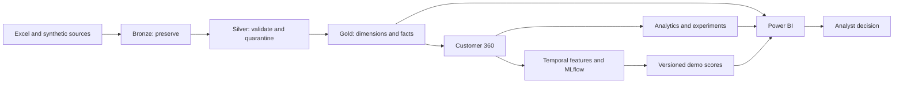
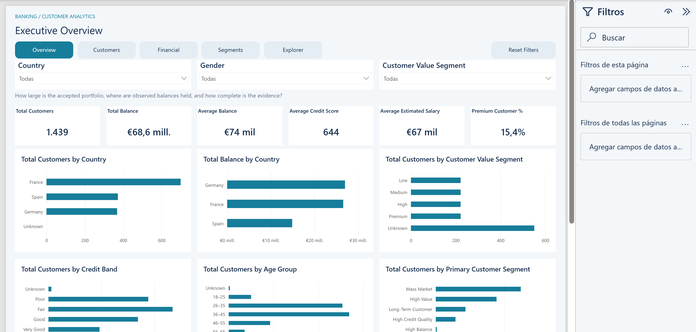

# Banking Customer Analytics Platform

An end-to-end banking analytics portfolio that turns fragmented customer data into validated customer profiles, decision dashboards, model scores and measurable experiment designs using Python, SQL and Power BI.

## Overview

**Portfolio demonstration; no bank deployment or commercial impact is claimed.** The original workbook is a limited customer snapshot with unverified provenance. Products, payroll, campaigns, digital behavior, satisfaction and model labels are synthetic. Experiments and value assumptions are simulated.

Start here: [five-minute demo](docs/interview/demo_5_minute.md) · [architecture](docs/architecture/high_level.md) · [measured project health](reports/final_project_health.md) · [interview pack](portfolio/interview/README.md) · [public portfolio](portfolio/public/README.md).

## Business problem

Fragmented customer information makes it hard to understand engagement, salary domiciliation, product adoption and campaign performance. This project consolidates those views, identifies opportunities and demonstrates how to test an action before scaling it. Propensity supports prioritization; a randomized experiment addresses whether an action changes an outcome.

## Architecture



[Full architecture](docs/architecture/high_level.md) · [engineering](docs/architecture/data_engineering.md) · [ML](docs/architecture/machine_learning.md) · [business analytics](docs/architecture/business_analytics.md). Quality gates, audit, CI and governance support each branch.

## Tech stack

| Purpose | Implemented locally | Reference or optional |
|---|---|---|
| Data engineering | Python 3.12, Pandas, Parquet/PyArrow, YAML contracts | Spark/Delta Databricks examples |
| Analytics engineering | SQL, DuckDB, dimensional models | Existing optional dbt-DuckDB project |
| Machine learning | scikit-learn, logistic regression, random forest, histogram gradient boosting, dummy baseline, MLflow | XGBoost and SHAP are interview alternatives, not implemented dependencies |
| BI | Power BI PBIP/PBIR/TMDL, Power Query, DAX | Power BI Service refresh design |
| Engineering | pytest, coverage, Ruff, Black, GitHub Actions, package build | Dockerfile supplied; daemon execution unverified |
| Cloud design | Paused Databricks job/reference configuration | Azure storage, Key Vault and Unity Catalog remain undeployed |

## Dataset and Medallion Architecture

The local workbook has **1,999 rows**: **1,439 accepted customers + 560 quarantined rows**. Bronze preserves source values and row lineage. Silver normalizes and validates records without turning missing balances into zero. Gold publishes immutable dimensions, a customer snapshot fact and business marts after quality and SQL/Pandas reconciliation. The workbook is excluded from version control; a fresh checkout uses the independent 120-customer TEST fixture.

The financial snapshot has no historical transactions or verified currency. Synthetic behavioral history ends September 30, 2026. Each layer distinguishes original snapshot data from **SYNTHETIC DEMO DATA**, **SYNTHETIC DEMO MODEL** and **SYNTHETIC DEMO ANALYTICS**.

## Customer 360

One row per accepted customer brings together profile, product depth, payroll, engagement, service adoption and satisfaction descriptors. The customer-value score is a transparent relative proxy, not CLV. Point-in-time ML features reconstruct dated behavior separately; current profile descriptors are not backfilled as historical truth.

## Power BI

¿Gráficos vacíos? Consulta [cómo abrir el informe con datos](powerbi/ABRIR_INFORME.md). La entrada local estable es `powerbi/.local/BankingCustomerAnalytics.pbip`.

The authored model contains **35 tables, 26 relationships and 209 measures**. There are **26 pages**, including hidden detail, quality and tooltip pages. The [page catalog and screenshot plan](docs/screenshots.md) identify each page and its purpose.

Demo flow: Executive Overview → Customer Profile → Digital Engagement → Primary Banking → Campaigns → Predictive Analytics → Next Best Action → Experimentation → Architecture → Data Quality. Scoped measures avoid mixing funnel stages, cohort definitions and attribution models.

Native validation passed **264 analytical comparisons across six scenarios**, with all 35 partitions ready. The expanded report's visual interactions and saved Desktop cache remain unverified because the UI helper failed. Earlier screenshots are historical evidence, not proof of the final layout.

## Machine learning

Four use cases predict campaign conversion, future digital inactivity (a churn proxy), first payroll domiciliation and Travel Plan activation. Pipelines compare a constant prior, logistic regression, random forest and scikit-learn histogram gradient boosting. Purged chronological splits separate fitting, calibration, model selection and held-out evaluation. MLflow records runs and artifacts; checksum-verified local champions support batch scoring.

**Held-out targeting performance is weak.** Payroll selected a constant prior; campaign top-decile lift is below one. These are synthetic demonstration models. Eligibility, ownership, contact caps and holdout rules constrain Next Best Action; scores do not establish incremental impact. See [actual model results](ml/reports/phase_summary.md).

## Advanced analytics and experimentation

27 analytical outputs cover journeys and sessionization, nested funnels, five cohort definitions, digital/product retention, lifecycle, three simulated randomized experiments, attribution, synthetic campaign economics and policy-aware opportunities. Future cohort months stay absent; historical balances and service-state retention are unavailable.

| Simulated experiment | Absolute conversion lift | Decision |
|---|---:|---|
| Payroll personalization | +9.20 percentage points | Below planned sample; do not scale |
| Travel channel | +7.30 points | Stop: guardrail failure |
| Digital re-engagement | +8.06 points | Winner within the simulation only |

The framework uses intention-to-treat denominators, SRM checks, Wilson rate intervals, contrast intervals, sparse-count Fisher tests, Holm adjustment and sample/guardrail decision gates. Attribution is descriptive; ROI uses synthetic value units. [Computed findings](analytics/reports/findings.md) include denominators, uncertainty, economics and limitations.

## Productionization

The local 13-task DAG supplies layered DEV/TEST/PROD configuration, seven contracts, critical quality gates, audit/logging, isolated attempts, checksum-verified resume, transient retries and a single-writer lock. CI definitions run tests, lint, policy, dependency audit and release-plan checks. External notifications, cloud execution and service refresh are not connected. Databricks task entry deliberately fails closed until a governed Delta adapter exists.

## Data quality and governance

Quarantine preserves rejected rows; export validation reconciles customer sets, types and counts. Synthetic models cannot be promoted into Production. Customer-level exports and models remain ignored. Public packaging uses an allowlist of aggregate material; masking/hiding fields is not access control. [Security findings](reports/security_findings.md) document remaining boundaries.

## Key business insights

- Missingness changes interpretation: 931 accepted customers have observed balances; 551 have an Unknown value score.
- The nested Primary Bank readiness funnel drops most by count at regular digital activity: 202 customers. This is a snapshot association, not a causal transition.
- Significant simulated lift alone is insufficient: payroll has not met its planned sample, and travel fails a guardrail.
- Weak ML signal supports cautious rules and measurement before any real targeting decision.

## Screenshots



Earlier native capture; EUR formatting is an unverified display assumption. [Screenshot provenance and capture checklist](docs/screenshots.md). [Experiment confidence intervals](analytics/reports/experiment_lift.png) and [retention heatmap](analytics/reports/retention_heatmap.png) are computed Python figures, not Power BI screenshots.

## How to run

From the repository root, using Python 3.12:

```powershell
python -m venv .venv
.venv\Scripts\Activate.ps1
python -m pip install --require-hashes -r requirements-dev.lock
python -m pip install --no-deps -e .
python -m orchestration.run_workflow --env test
python -m pytest tests ml/tests analytics/tests --cov -q
```

TEST creates its own source and prior-model fixture. For the existing local workbook and trusted demo champions, run `python -m orchestration.run_workflow --env dev`. The [reproduction guide](docs/reproduce.md) gives exact downstream analytics, notebook and Power BI commands. Do not combine unrelated build manifests.

## Tests

[Final health](reports/final_project_health.md) records actual execution, row counts, coverage, notebook checks and native evidence. [Repository audit](reports/repository_audit.md) distinguishes removed duplication from retained historical/compatibility assets. Formatting/linting scope is explicit in pyproject.toml; legacy modules are not represented as fully linted.

## Limitations

The source is limited and its provenance unverified; behavior and labels are synthetic; experiments are simulated; value and currency assumptions are unverified. No real bank data, campaign delivery, causal lift or production deployment is claimed. ML signal is weak; attribution is rule-based. Final Desktop visual/cache acceptance and Docker execution remain outstanding.

## Future improvements

First obtain governed real outcomes and timestamped ownership/consent, validate definitions with stakeholders, and run an approved experiment. Then implement cloud execution and service refresh if operations justify them. Uplift modeling or streaming should follow a demonstrated need and suitable data. [Roadmap](docs/interview/limitations_roadmap.md).

## Interview summary

“I started with a limited banking customer snapshot and built a reproducible way to turn it into trustworthy profiles and dashboards. I added clearly labeled synthetic behavior to demonstrate targeting and experimentation, then tested the pipeline and reconciled the report. The most useful lesson was knowing when evidence does not support scaling a campaign or trusting a more complex model.”

[Two-minute story](docs/interview/demo_2_minute.md) · [STAR stories](docs/interview/star_stories.md) · [technical Q&A](docs/interview/technical_questions.md) · [business Q&A](docs/interview/business_questions.md) · [CV and LinkedIn](docs/interview/career_positioning.md).
