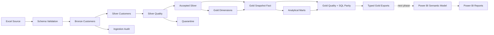

# Banking Customer Analytics — validated Gold and BI-ready star

This repository now implements Excel → Bronze → accepted Silver → Gold dimensions, customer snapshot fact, calibrated segmentation, reusable metrics and analytical marts. Final Power BI semantic-model/report authoring is the next phase; current outputs are typed Parquet/CSV plus model/measure specifications.



## Run

Python 3.12 was used for verification. From this repository:

```powershell
python -m venv .venv
.venv\Scripts\Activate.ps1
python -m pip install -r requirements.txt
python run_pipeline.py --stage all
python run_pipeline.py --stage gold
pytest
python -m tools.verify_gold_outputs
python -m tools.run_sql
```

`all` ingests a new source batch, builds Silver/quality/quarantine, then publishes Gold. `gold` reads the latest completed accepted Silver batch and creates a new immutable Gold build; it does not rerun upstream ingestion. `--batch-id` selects an existing published Silver batch for Gold. Bronze, Silver and quality remain independently executable. A failed structural/Gold reconciliation check raises and cannot advance the Gold publication pointer.

`data/reports/latest_gold.json` is the authoritative Gold manifest. Its directories contain 17 Parquet tables and 17 CSV exports, type metadata, independent SQL warehouse, actual calibration, source inspection, business findings, checksums and Gold quality/SQL parity reports. Do not combine tables from different builds. The [runbook](docs/gold_runbook.md) gives exact paths, stage behavior, optional dbt and Databricks execution.

## Actual source population

The original workbook is preserved: `dataset.xlsx`, sheet `Total Data`, zero-based header row 1. Source ingestion contains 1,999 rows; existing Silver rules produce 1,439 accepted customers plus 560 quarantined rows. Gold consumes all 1,439 accepted PASS/WARNING customers, not the obsolete initial 1,986-customer key-only population. Missing balances remain missing; 931 customers have observed balances, and 888 have complete value-proxy inputs. No thresholds were relaxed to make the source pass.

## Gold products

The core star has five integer-key dimensions (`dim_customer`, `dim_country`, `dim_age_group`, `dim_credit_band`, `dim_tenure_band`) and `fact_customer_financials`. Each dimension filters the fact directly in one direction. Lookup dimensions include configured Unknown/unobserved members; no snowflake or many-to-many relationship is required. The fact is one customer in the current snapshot and has no invented financial date.

Marts cover customer segments, country/age/credit/tenure summaries, executive KPIs, balance concentration, IQR outliers, descriptive profiles, normalization/weight sensitivity and actual calibration parameters. Each table has a documented business purpose and grain. Financial copies in dim_customer are for restricted profiling/lineage and must be hidden from ordinary BI aggregation.

The customer-value score is a transparent **analytical proxy**, not CLV or profitability. It uses configurable 40/25/20/15 weights over balance/salary/tenure/credit components. Percentile-rank normalization is selected after comparison with fixed-anchor min–max: it bounds the influence of extreme amounts while preserving relative order. Positive-weight inputs must all be observed. Complete-score quartiles define Low/Medium/High/Premium without splitting ties; incomplete scores remain Unknown. Scenario checks show material sensitivity to balance and weights, so the score is exploratory rather than an approved decision policy.

Overlapping flags support High Value, High Balance, High Income, Affluent, High Credit Quality and Long Tenure profiles. A documented priority creates one primary segment. Rules use accepted-data quantiles and configured credit bands; age/gender do not infer profession or personal traits. See [Gold methodology](docs/gold_models.md), [metric definitions](docs/metric_definitions.md) and the [current build summary](docs/gold_build_summary.md).

## Code, SQL and validation

| Location | Purpose |
|---|---|
| `src/ingestion`, `src/transformations/silver_customers.py` | Existing validated upstream layers and quarantine policy |
| `src/transformations/gold/` | Modular dimension/fact, value, segments, summaries and diagnostics |
| `src/gold_pipeline.py`, `src/quality/gold_checks.py` | Immutable publication, reconciliation and relational quality |
| `sql/gold/` | Canonical SQL models, independent from Pandas business calculations |
| `sql/analytics/` | Fifteen executable business queries: rankings, distributions, associations, concentration and outliers |
| `dbt/models`, `dbt/macros`, `dbt/tests` | Runnable DuckDB dbt models, contracts and relationship/domain tests |
| `notebooks/03_gold_business_analysis.ipynb` | Business analysis using Gold only |
| `databricks/03_gold_pipeline.py` | Spark SQL-native Gold/Delta example over published Silver |
| `powerbi/model/*.md`, `powerbi/dax/measures_specification.md` | Current star, import mapping and authored measure catalog |

Python tests include keys, scoring/ties/missingness, segments, aggregates, concentration, relationships, source/fact reconciliation, failure policies and independent SQL/Pandas parity. Each real build checks dimensions, customer sets, keys, foreign keys, values, scores, labels, counts and mart totals. Both balance and salary reconcile to accepted Silver. The warehouse executes all 12 comparable SQL business tables and checks every output column against Python before publication.

Optional dbt: install `dbt-duckdb>=1.10,<2`, copy `dbt/profiles.example.yml` to `dbt/profiles.yml`, then `python -m tools.run_gold_dbt`. It supplies the current warehouse and stored configuration. The initial verification passed 17 dbt models and 50 data tests. See [verification](docs/verification.md) for final local results and target-environment limits.

## Power BI analytical solution

The current `powerbi/BankingCustomerAnalytics.pbip` references a textual TMDL semantic model and enhanced PBIR report. Architecture: Excel → Bronze → Silver → Gold → Star Schema → Semantic Model → DAX → Executive Analytics. Ten tables comprise six core star tables, three disconnected cohort/control tables and _Measures. Five one-to-many relationships filter the customer-grain fact in one direction. All 61 measures have descriptions, folders, formats and page mappings in [the DAX catalog](powerbi/dax/measures.md).

| Main page | Business question |
|---|---|
| Executive Overview | How large is the portfolio and where are balances concentrated? |
| Customer Profile | Who are the customers? |
| Financial Analysis | How do balances, salary and credit differ? |
| Segmentation | Which groups have different financial profiles? |
| Customer Explorer | Which records explain the aggregates? Authorized analysts only. |

Hidden supporting pages provide Customer Detail drill-through, Country Tooltip, Segment Tooltip and Data Quality. Definitions include navigation, reset, synchronized slicers, dynamic titles, conditional formatting and a neutral banking theme. **Native Desktop repair completed:** all ten tables refreshed, charts render, all 61 measures evaluated and 360 core DAX comparisons passed across twelve filter scenarios. Dedicated slicer/bookmark/drill-through interaction acceptance remains pending. See [native repair evidence](docs/powerbi_native_repair.md). No PBIX binary or workspace deployment is claimed.

### Open and refresh

After publishing Gold, run `python -m tools.prepare_powerbi` and open the printed local PBIP path in a current Power BI Desktop supporting PBIP, TMDL and enhanced PBIR. The ignored local copy points to the latest successful Gold build. Refresh all tables together. For the portable tracked PBIP, first set GoldDataPath to the manifest's powerbi_path directory, preserving its sibling build metadata. Never mix tables from different builds. Keys import directly as Int64 to avoid rounding.

For a complete textual rebuild, install Python requirements, .NET SDK 10 and Node.js, run `npm ci --prefix tools/powerbi_validation/powerquery`, then `python -m tools.build_powerbi`. This overwrites generated definitions and creates a fresh ignored local copy; preserve intentional report edits before regeneration. See [the dashboard guide](docs/powerbi_dashboard.md) and [Databricks architecture](docs/powerbi_databricks_architecture.md).

### DAX and actual findings

```dax
Total Balance = SUM('Fact Customer Financials'[Balance])
Average Balance = AVERAGE('Fact Customer Financials'[Balance])
Balance per Customer = DIVIDE([Total Balance], [Total Customers])
Premium Customer % = DIVIDE([Premium Customers], [Total Customers])
```

Average Balance excludes missing balances; Balance per Customer includes all selected customers in its denominator. The accepted population has 1,439 customers, 931 observed balances and 888 complete proxy scores. Total observed balance is 68,552,786.88. France leads customer count and Germany leads observed balances. Premium has 222 customers; 551 have Unknown scores. The top 10% of observed-balance customers (94 of 931) hold about 22.8% of observed balances. These describe the accepted snapshot; requested EUR formatting is an unverified display assumption.

### Verification and screenshot slots

The complete pipeline passed 69 Gold checks and reconciled 12 SQL/Pandas tables. Local evidence includes 103 passing Python tests, Microsoft TOM/TMDL round-trip, 182 JSON schema files, 13 M syntax checks and 557 independent metric-reference comparisons. Native Desktop verification subsequently evaluated all 61 measures and passed 360 core comparisons; detailed interaction acceptance remains separate. See [validation evidence](docs/powerbi_validation.md) and [the Desktop acceptance checklist](docs/dashboard_demo_checklist.md).

Native Overview and Financial screenshots are now under powerbi/screenshots. Nine real-data design previews remain under powerbi/previews, with identifiers masked; those are Python renderings. [Screenshot checklist](powerbi/screenshots/README.md) covers: Overview, Profile, Financial, Segmentation, masked Explorer/Detail, tooltips and Quality.

[Interview scripts](docs/interview_story.md) provide 60–90 second, three-minute and five-minute explanations. [Future banking extensions](docs/powerbi_future_extensions.md) cover products, payroll, campaigns and digital engagement with synthetic demonstrations kept separate from real data. Earlier .bim/root .pq/design assets remain historical references; the PBIP folders and current catalogs are authoritative.

## Limits, privacy and history

No transactions, products, campaign history, churn target, revenue, profitability, time series or interaction data are present. The project does not calculate real churn/CLV, conversion, monthly trends or profit. Technical timestamps/batch IDs are lineage only. Currency and salary period remain unverified; requested EUR formatting does not convert or establish currency. Descriptive association is not causality.

Customer IDs and linkable keys are sensitive. Generated data, logs and warehouses are Git-ignored. Real deployment needs governed access, encryption, minimization, masking, retention and audit controls; hiding a field is not security. Original Excel and exploration notebook are preserved. Historical documentation is under `docs/history`; the upstream phase guide remains available at [phase_bronze_silver.md](docs/phase_bronze_silver.md). Local execution assumes a single writer; Databricks code requires target runtime/security validation.
