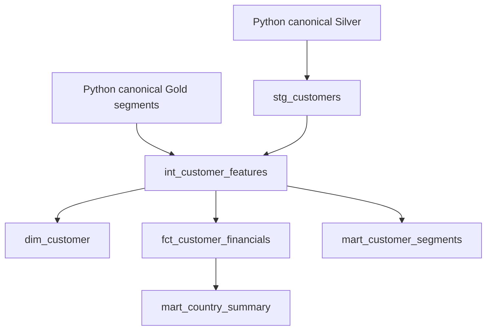

# Optional dbt runtime

**Current Gold phase:** run `python -m tools.run_gold_dbt` from the repository root after a successful Gold build. It selects `data/reports/latest_gold.json`, the current build warehouse and its exact snapshot configuration. Canonical models now compute keys, score, tiers and segments independently from accepted Silver and explicit configuration seeds. Seventeen models and 50 tests have been verified. The old latest-success warehouse instructions below are historical; see [the Gold runbook](../docs/gold_runbook.md) for current paths and model parity.

The local pipeline needs no dbt installation. This is a runnable **DuckDB adapter** project over the per-batch warehouse. Python owns source validation and configurable business rules; dbt reuses published segments instead of maintaining a second, subtly different scoring formula. This models contracts, dependencies, tests and marts rather than pretending dbt parses Excel.

Install `dbt-duckdb>=1.10,<2` separately. Copy `profiles.example.yml` to `profiles.yml`, then set `BANKING_WAREHOUSE` to the absolute `data/reports/<published-batch>/analytics.duckdb` file. From the repository root:

```powershell
$env:BANKING_WAREHOUSE = (Resolve-Path 'data/reports/<batch>/analytics.duckdb').Path
dbt build --project-dir dbt --profiles-dir dbt
dbt docs generate --project-dir dbt --profiles-dir dbt
```

Dependencies:



Models live in `dbt_analytics`, separate from `main` source tables. Re-running Python produces a new warehouse; repoint the environment variable before dbt builds the new batch. This avoids stale compiled models reading a different snapshot.
