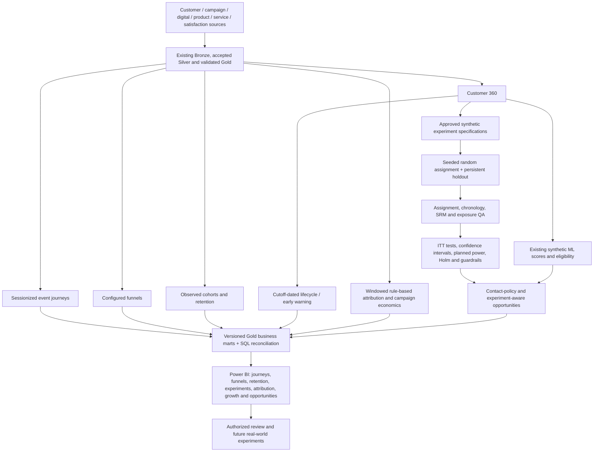

# Advanced analytical architecture

Every behavioral mart, simulated experiment, chart and new report page is **SYNTHETIC DEMO ANALYTICS**. The layer extends the existing platform; it does not replace Medallion transforms, Customer 360, ML, governance or the saved prior report.

Core logic is in `analytics/src`; configuration in `analytics/config/analytics_config.yaml`; approved simulation specifications in `experiments/`. `run_analytics_pipeline.py` reads coherent existing synthetic/ML build IDs. `--release <validated platform release folder>` accepts the productionization layer's independent local release. This makes a no-private-data fixture E2E possible. Failed analytical builds retain a FAILED marker and do not advance the successful analytics pointer.

Successful builds live in `data/gold_analytics/build_id=...` with Parquet, CSV, a DuckDB `gold` schema, quality checks, SQL results, config/spec/source/model lineage and content checksums. `data/reports/latest_analytics.json` publishes only after all structural quality and export checks pass. Notebook logic only calls reusable functions or reads stored evidence.

The existing 13-task operational workflow remains intact. Analytics is a downstream validated-release consumer, not a hidden side effect of ML training or BI refresh. A production scheduler should depend on one approved Gold/feature/model release, run analytics QA, publish immutable marts and only then request BI refresh. No real marketing action, cloud deployment or real-world lift is claimed.
