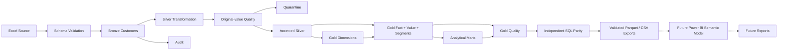

# Architecture through Gold

Bronze preserves original cell values, metadata and checksums; Silver performs explicit validation/normalization with lossless accepted/quarantine row accounting. Those upstream policies remain intact. Gold reads only published accepted Silver and adds stable integer surrogate keys, configured dimensions, a customer snapshot fact, relative value proxy, explicit segment flags, fixed-grain marts and diagnostics.

Current output publication is atomic at a latest-build manifest pointer after quality, export read-back and independent SQL parity. Individual Parquet/CSV files and Delta tables are not a distributed transaction. Use single-writer orchestration, run-scoped storage and a successful build marker; never mix tables from independent builds. Failure leaves the prior Gold pointer unchanged. Source batch and Gold build IDs have different meanings and both are recorded.

The six core exports form a direct five-dimension star; repeated lookup/financial columns in dim_customer are hidden convenience copies, not additional relationship paths. Aggregates are alternate fixed-grain products, not facts to join indiscriminately. No customer observation date is inferred from ingestion/build timestamps.

Databricks renders the same core SQL with native Spark hashing, exact percentiles and windows, then persists run-scoped Delta tables and quality/publication records. It does not collect source rows. Its appended tables require a single successful build filter, governed readers and coordinated refreshes; full workspace execution is not established by local tests.

See [Gold models](gold_models.md), [execution runbook](gold_runbook.md), [metrics](metric_definitions.md), [star](../powerbi/model/star_schema.md) and [connection options](powerbi_connection.md). Initial and previous-phase architecture documents are retained under history/.
