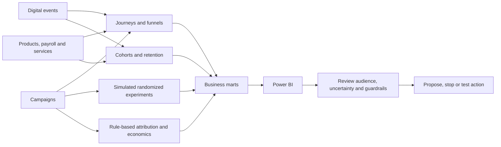

# Business analytics and decision flow

Sessions are reconstructed with a configured inactivity timeout; funnels use nested eligible populations and explicit windows. Five cohort definitions track observed age periods without fabricating future months. Lifecycle rules distinguish inactivity, engagement and relationship depth. The Primary Bank funnel is cross-sectional readiness, not observed chronological progression.

Simulated experiment assignment is separate from historical observational campaigns. Intention-to-treat, sample-ratio checks, planned samples, multiplicity and guardrails precede a winner decision. Attribution allocates descriptive credit under four rules and 7/30-day windows; costs are conserved independently. Economic values are synthetic units, not verified bank profit.

Policy-aware opportunity scores combine current eligibility, contact limits, ownership and cautious evidence. Validated simulated lift is restricted to the original eligible trial population. No campaign is delivered and no real causal lift is claimed.
