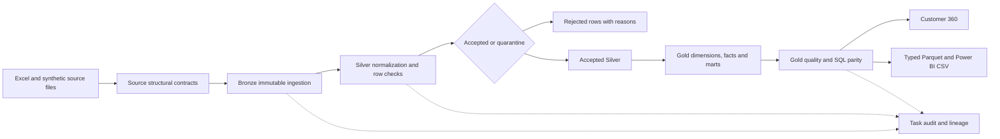

# Data engineering and quality flow

The original source has 1,999 physical rows; 1,439 accepted plus 560 quarantined reconciles exactly. Bronze preserves original business values, source row references and checksum. Structural source validation precedes ingestion; accepted-domain content/key contracts run after cleansing. Missing balances stay null. Critical failures block publication; noncritical warnings remain visible.

The original Gold fact is one customer in an undated financial snapshot. Event facts have explicit event grains. Dimensions use stable integer keys. A completed immutable build has independent SQL reconciliation and export checks before its latest-success pointer advances. Original Gold and the controlled platform release use distinct pointers; consumers must select a coherent release.

The local DAG has 13 tasks, isolated retry attempts, durable audits, a single-writer lock and checksum-verified recovery. Snapshot processing is full refresh. Event watermark/upsert logic is a separately tested primitive, not an implemented streaming pipeline. Cloud Delta adapters remain undeployed.
