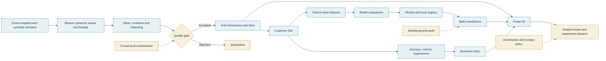

# Banking Customer Analytics architecture

Purpose: turn fragmented customer information into reliable insights and testable customer opportunities. Solid arrows describe the local executable path. Cloud deployment and Power BI Service remain reference designs.

Source of truth: src/ for transformations, orchestration/ for controlled execution, ml/ for offline learning, analytics/ for business measurement and powerbi/ for the authored report. The analytical branches use synthetic behavior and are labeled accordingly. No diagram arrow represents an actual external campaign send.

[30-second version](interview.md) · [engineering](data_engineering.md) · [ML](machine_learning.md) · [business analytics](business_analytics.md) · [measured health](../../reports/final_project_health.md).
