# ML architecture and actual model choices

```mermaid
flowchart LR
    C[Customer 360 and dated events] --> F[Point-in-time allowlisted features]
    F --> S[Purged temporal train, validation, test]
    S --> T[Prior, logistic, forest, histogram boosting]
    T --> M[MLflow runs and artifacts]
    M --> R[Validation-selected local champion]
    R --> B[Checksum-verified batch scoring]
    B --> G[Gold scores and gated next actions]
    G --> P[Power BI]
```

The implemented boosted estimator is **HistGradientBoostingClassifier**, not XGBoost. XGBoost is discussed as an alternative in interview preparation. SHAP is not installed; explanations use supported coefficients, feature importance, permutation importance and local perturbations.

Targets: campaign conversion, future inactivity, first payroll domiciliation and Travel Plan activation. Fitting is Jan–Dec 2025, early calibration Jan 2026, February purged, selection March–April and held-out test May–August. Campaign rows also respect launch-specific label end dates. Protected/audit fields and unversioned financial snapshots are excluded from predictors.

Validation selects models; the held-out test reports limitations. Campaign chose logistic regression; churn and service chose histogram boosting; payroll chose a constant prior. Weak holdout signal is an outcome to explain, not hide. All models are SYNTHETIC DEMO MODEL; a local Champion is not Production approval. MLflow tracking and model lifecycle policy are separate concerns. Eligibility and contact rules always constrain scores.

[Model results](../../ml/reports/phase_summary.md) · [leakage policy](../ml_leakage_prevention.md).
