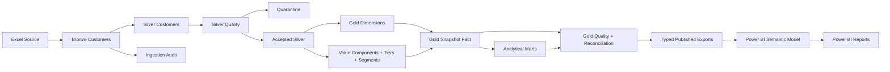

# End-to-end lineage through Gold

| Output | Input / rule | Grain / trace |
|---|---|---|
| Bronze | Actual Excel + explicit header/schema contract | One source row; file checksum, batch, worksheet row |
| Accepted Silver / quarantine | Original-value masks, normalization, first-row duplicate rule | Disjoint physical-row partition; accepted IDs unique |
| Gold lookup dimensions | Explicit configured bands/country lookup + observed country names | Stable namespaced integer keys and Unknown=0 |
| Gold customer dimension | Accepted Silver + value and segment enrichment | One accepted customer, raw ID available for restricted lineage |
| Gold fact | Same enrichment + keys | One customer in the current snapshot, source_batch_id |
| Value/tier parameters | Observed accepted component values + configured weights/quantiles | One reproducible calibration record per build |
| Summary/KPI marts | Enriched accepted customer population | Country, age, credit, tenure or whole-snapshot aggregation |
| Profile/concentration/outlier/evaluation marts | Gold features plus documented analytical rules | Explicit cohort/variable/scenario grains |
| SQL business models | Accepted Silver + static configuration seeds | Independent core-model calculation compared to Python |
| Typed BI exports | Reconciled business tables | Same build ID, table checksum, explicit schema metadata |

Gold manifests record source Silver file checksum, upstream publication manifest, source batch, Gold build ID, complete Gold config hash/snapshot, table row counts and output checksums. Raw invalid values remain in Bronze/quarantine and do not re-enter Gold. Customer IDs join Gold dimension back to accepted Silver for restricted investigations; source rows remain available upstream. Hash keys are linkable pseudonyms and not anonymization.

Customer counts, observed balances and estimated salaries reconcile from accepted Silver to fact and summary marts. Nulls remain unknown; totals are not reconciled to invalid/raw Bronze amounts. No temporal or transaction lineage is invented. Detailed table grains are in [Gold models](gold_models.md).
