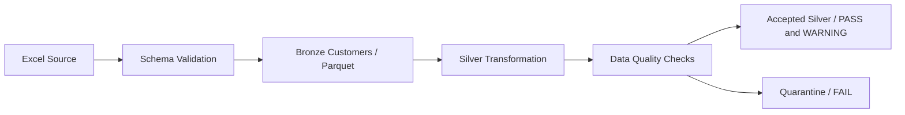

# Banking Customer Analytics — Source, Bronze and Silver

The active phase implements a reproducible Excel → Bronze → Silver pipeline, including source contracts, ingestion audit, record quality flags, deterministic duplicate handling, analytical bands and quarantine. The original Excel/notebook, previous batches and deferred Gold/Power BI assets are preserved.



## Run

From the repository root, using Python 3.12:

```powershell
python -m venv .venv
.venv\Scripts\Activate.ps1
python -m pip install -r requirements-pipeline.txt
python run_pipeline.py
python -m pip install -r requirements.txt
pytest
```

`requirements-pipeline.txt` is the minimal runtime for this phase; the existing full requirements also support historical tests/assets. The pipeline uses Pandas, NumPy, openpyxl, PyArrow and YAML; Spark is optional and not installed locally. All production paths and policies come from `config/config.yaml`.

```powershell
python run_pipeline.py --stage bronze --source dataset.xlsx
python run_pipeline.py --stage silver
python run_pipeline.py --stage quality
```

Optional: `--config <yaml>` and `--batch-id <id>`. `all` means Bronze + Silver only. Downstream stages consume completed Bronze and retain any source override from its configuration snapshot. Changing other rules for the same batch fails; ingest a new batch instead. Exceptions return nonzero exit status with structured logs.

## Verified source and outputs

The actual workbook is `dataset.xlsx`, sheet `Total Data`, headers on the second row (`header_row: 1`). Its eight fields match the canonical contract. Source ingestion checks file/sheet validity, headers, schema and emptiness; syntactic name normalization and explicit aliases are logged rather than guessed.

The inspected snapshot produces **1,999 Bronze rows = 1,439 accepted Silver rows + 560 quarantined rows**. There are 13 later duplicate rows, 401 invalid credit scores, 186 invalid ages and 707 missing balances; check counts overlap. Accepted Silver retains missing amounts as null with WARNING flags. Critical invalid numeric records and unusable keys are quarantined, never discarded. Exact source values remain in Bronze.

Read `data/reports/latest_silver.json` for the published accepted/quarantine/quality locations. `data/reports/latest_bronze.json` tracks completed raw ingestion. Local storage is immutable by Bronze batch ID, with per-attempt audit Parquet and UTC metadata. `read_bronze` verifies file integrity and reverses mixed-cell storage encoding. Source/config hashes and physical worksheet rows support reproducibility.

Source-level PASS/WARNING/FAIL check reports and `exploration_summary.json` live under `data/silver/_quality/batch_id=<id>/`. Set `quality.block_on_fail: true` to block accepted publication on aggregate failures; diagnostics and quarantine still persist. Default false supports examining this intentionally imperfect source after isolating critical records. Missing values are never imputed or turned into zero.

## Code and documentation

| Location | Purpose |
|---|---|
| `src/ingestion/source_validator.py` | Excel validation and explicit column normalization |
| `src/ingestion/bronze_ingestion.py` | Batch-aware Parquet, checksum verification and ingestion audit |
| `src/transformations/silver_customers.py` | Reusable vectorized cleaning, flags, bands, duplicates and routing |
| `src/quality/data_quality_report.py` | Aggregated source checks and exploratory validation summaries |
| `src/utils/config.py`, `logger.py` | Validated centralized settings and JSON logs |
| `src/pipeline.py`, `run_pipeline.py` | Source-to-Silver stage orchestration and publication |
| `notebooks/01_bronze_silver_pipeline.ipynb` | Local/Colab walkthrough, optional upload and export |
| `databricks/01_bronze_silver_pipeline.py` | Excel landing, Delta Bronze/audit, Spark-native Silver/quality |
| `tests/` | Synthetic source, edge-case, storage, policy and integration checks |

Read the [complete phase guide](docs/phase_bronze_silver.md), [architecture](docs/architecture.md), [business rules](docs/business_rules.md), [dictionary](docs/data_dictionary.md), [lineage](docs/data_lineage.md) and [verification record](docs/verification.md).

## Scope, privacy and next phase

No Gold or Power BI processing runs in this phase. Existing analytics/SQL/dbt/report assets are historical material for future compatibility, not outputs of the current CLI. Previous documentation is archived under `docs/history/initial_project/`. The next phase will build/revalidate Gold and semantic models against the new accepted Silver population. Do not combine old Gold snapshot counts with current Silver.

Treat IDs and financial data as sensitive. Runtime data and audit outputs are Git-ignored; already tracked source files remain tracked. Avoid publishing real customer source/exports or notebook outputs without authorization. Real deployment needs governed access, encryption, minimization, masking, audit retention and privacy review. The dataset lacks business dates, products, transactions, profitability, campaigns and churn labels; no corresponding analyses are inferred. Currency and salary period remain unverified.
