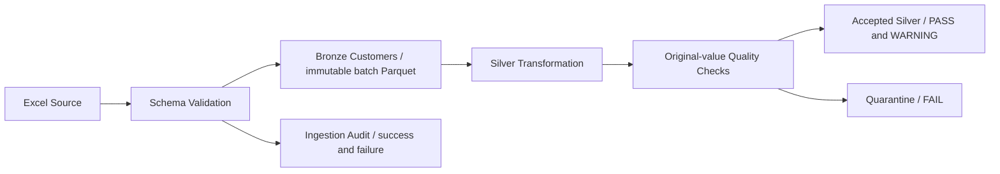

# Active architecture: Source → Bronze → Silver

Source validation rejects corrupt/missing files, missing sheets, empty data, duplicate headers and missing/unexpected columns. Only documented syntactic normalization or configured semantic aliases change column names. Business values remain untouched in Bronze.

Bronze contains raw values plus UTC ingestion metadata, source checksum, batch and worksheet row. Native Parquet values are used where possible; heterogeneous columns use explicit reversible tagged-cell encoding recorded in the manifest. `read_bronze` restores values and verifies checksum/count. Each batch directory is reserved once; failed and successful audit attempts are separate records.

Silver uses vectorized numeric validation, explicit country/gender aliases, reproducible bands and deterministic first-physical-row deduplication. Original-value checks precede nullification. Missing numeric values remain warning/null/Unknown; malformed or out-of-range values are critical by default. Accepted and quarantine outputs partition every source row exactly once.

An atomic latest-Silver pointer advances only after accepted/quarantine persistence and read-back reconciliation. Data-quality evidence persists even under a strict failed gate. Local execution assumes one writer; partially written unreferenced batches are retained for diagnosis and must not be used as published data.

The optional Databricks entry point lands Excel using the same validator, persists Delta Bronze/audit and executes Silver with Spark-native expressions/windows. All tables retain batch IDs. Successful batches are recorded in `silver.customer_publications`; consumers select a specific batch. Delta transactions are per table, so multi-table orchestration and reader coordination remain necessary.

The existing Gold/BI assets are deferred and unchanged. See the [phase guide](../../phase_bronze_silver.md) for exact locations, policy, limitations and target-environment notes; previous architecture is preserved in `history/initial_project/architecture.md`.
