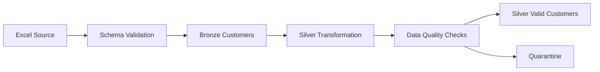

# Source-to-Silver lineage

| Output | Input | Transformation / trace |
|---|---|---|
| Source validation result | Actual Excel headers, sheet, cell values + config | File/sheet/schema checks, explicit name mapping, types/count |
| Bronze Parquet | Validated Excel values | UTC metadata + batch, checksum, physical row; reversible encoding only |
| Ingestion audit | Each ingestion attempt | Source, read/write counts, status and error; independent immutable record |
| Record quality flags | Original Bronze values + configured rules | Missingness, numeric domain/type, category and identity checks before cleaning |
| Accepted Silver | Cleaned annotated Bronze | First ID occurrence, normalized attributes, valid numeric values/nulls, bands; PASS/WARNING only |
| Quarantine | Same annotated Bronze | Critical failures and later duplicates; source metadata + issues/count/reason |
| Quality report | Original Bronze checks | One row/check/batch, full source denominator and thresholds |
| Exploration summary | Source checks + accepted/quarantine partition | Counts, distinct IDs, missingness and accepted band/category distributions |
| latest_silver.json | Validated persisted outputs | Atomic publication pointer after exact physical-row reconciliation |

Join accepted or quarantine records to their source using `_batch_id` + `_source_row_number`. Workbook and configuration hashes identify the source and rules. Full configuration is snapshotted per batch. Accepted plus quarantine row sets must be disjoint and equal the Bronze row set, not merely have equal total counts.

There is no edge to Gold or Power BI in this phase. Previously created assets are deferred and their historical lineage is preserved in `history/initial_project/data_lineage.md`. Local paths and the optional Delta batch-publication convention are documented in the [phase guide](../../phase_bronze_silver.md).
