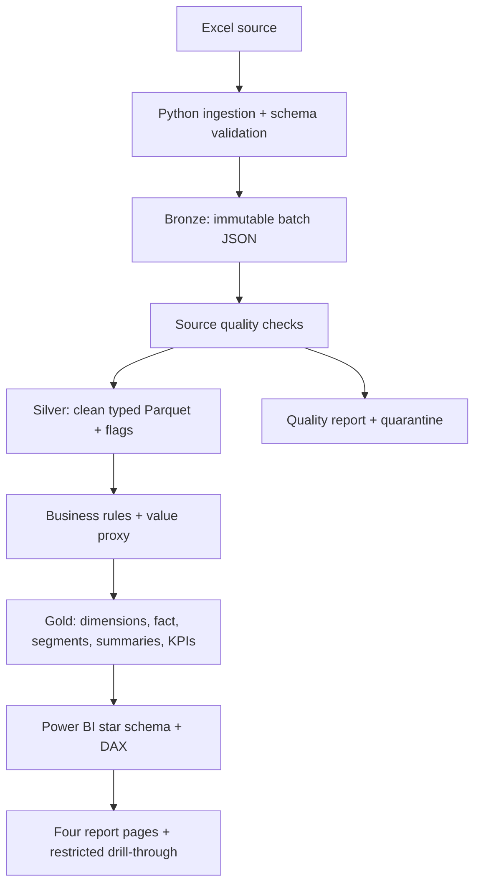

# Banking Customer Analytics

An end-to-end customer analytics portfolio project: Excel ingestion, Bronze evidence, validated Silver customers, Gold dimensions and facts, quality checks, SQL/dbt marts, and a Power BI semantic model. Python owns the business rules, so notebooks and the bounded Databricks adapter use the same transformations.

The supplied `dataset.xlsx` and `data_mining_arden_final.ipynb` are preserved. The workbook contains **1,999 records**, with headers on the second row of sheet `Total Data`. Configuration points to the actual file. To use `data/raw/customers.xlsx`, change `paths.source`; also set its sheet and zero-based header row explicitly. Unexpected or missing columns fail ingestion.



## Run locally

Python 3.12 was used for verification. From this repository:

```powershell
python -m venv .venv
.venv\Scripts\Activate.ps1
python -m pip install -r requirements.txt
python run_pipeline.py
python -m pytest -q
python -m tools.run_sql
python -m tools.render_report_previews
```

The full pipeline creates a unique batch, preserves source records, standardizes customers, evaluates quality, validates Gold keys/grain/reconciliations, exports CSV and Parquet, builds a DuckDB warehouse, and produces EDA charts and observations. `data/reports/latest_success.json` identifies the published batch and its Gold folder. `business_insights.md` and `business_questions.md` in the batch report folder contain the generated findings. The preview command creates four static report designs in the same folder under `powerbi_previews`; these are design references, not interactive Power BI reports. All dates in ingestion logs are UTC technical metadata; they are not business observation dates.

Independent stages:

```powershell
python run_pipeline.py --stage bronze
python run_pipeline.py --stage silver
python run_pipeline.py --stage gold
python run_pipeline.py --stage quality
python run_pipeline.py --stage eda
```

Non-ingestion stages default to the last ingested batch; use `--batch-id <id>` to select one explicitly. A full run creates a new batch. Published batches cannot be rebuilt in place. Inspect `latest_success.json` rather than assuming the latest ingestion was published. Output directories and logs are ignored by Git.

Quality failures **remain visible and do not block publication by default**, allowing this intentionally imperfect dataset to demonstrate the whole workflow. Set `quality.block_on_fail: true` for strict gating. Structural failures, invalid schemas, unusable customer keys, and Gold reconciliation failures always raise errors. The threshold comparison is strictly greater than the configured percentage.

## Repository guide

| Path | Purpose |
|---|---|
| `config/config.yaml` | Paths, schema, validation, bands, segments, score weights and quality policy |
| `src/ingestion`, `transformations`, `quality`, `analytics`, `utils` | Reusable, tested pipeline functions |
| `run_pipeline.py` | Stage orchestration and explicit failure propagation |
| `data/{raw,bronze,silver,gold,reports}` | Private, generated local data artifacts |
| `notebooks/00…06` | Setup, Bronze, Silver, Gold, quality, EDA and Colab entry |
| `sql/silver`, `sql/gold` | Eleven executable analytical/diagnostic queries |
| `dbt` | Optional runnable DuckDB project, model documentation and tests |
| `databricks` | Shared-rule Excel snapshot adapter, Spark and Delta examples |
| `powerbi/model` | Typed Power Query imports, relationships and Tabular model definition |
| `powerbi/dax`, `powerbi/theme.json` | Measures and financial report theme |
| `powerbi/dashboard_specification.md` | Four page designs, visual field mappings and interactions |
| `docs` | Architecture, dictionary, rules, lineage, privacy, operations and limitations |
| `tests`, `.github/workflows` | Boundary/integration checks and portable CI |

## What is available now

The local pipeline produces ten Gold tables, including a sensitivity mart. On the supplied source, 1,986 unique customers remain after 13 later duplicate rows are quarantined. Source checks flag 401 invalid credit scores, 186 invalid ages and 707 missing balances. These are source record counts and can overlap.

The score uses fixed normalization bounds and configurable weights (40% balance, 25% estimated salary, 20% tenure, 15% credit score), clipped to a 0–100 scale. All four inputs must be present. This is a **customer-value proxy**, not profitability or lifetime value. In the inspected snapshot only 985 customers are scored. Removing balance changes approximately 47.9% of their value categories, so the score requires business review before operational use. See [business rules](../../business_rules.md).

## Power BI

Follow [semantic model setup](../../../powerbi/model/README.md), import the four core tables, add [DAX measures](../../../powerbi/dax/measures.dax), apply the theme and implement the [report specification](../../../powerbi/dashboard_specification.md). The `.bim` definition provides the same model for Tabular tooling. This repository supplies model/report construction assets; it does **not** include an authored or Desktop-validated `.pbix` report.

The fact grain is one retained customer in the current source snapshot. Three dimensions filter the fact in one direction. Use fact-based measures so country, age and customer slicers all affect counts correctly. Aggregate marts are separate analytical outputs, not additional joined facts that could multiply totals. Financial averages exclude null values. Coverage measures make that exclusion visible.

Pages cover executive overview, demographics, financial relationships and segmentation. Questions include customer composition, countries with the largest observed balances, credit quality by cohort, salary/balance association, tenure, value concentration and possible campaign cohorts. The EDA report labels facts, observations, hypotheses and recommendations separately.

## Notebooks and other environments

Open notebooks from `notebooks/` and run in order. `05_exploratory_analysis.ipynb` displays descriptive statistics, missingness, outliers, all requested scatter relationships, correlation with pair counts, sensitivity and business observations. The original exploration notebook is historical work and is not a pipeline dependency.

For Colab, use [06_colab_entry.ipynb](../../../notebooks/06_colab_entry.ipynb). Upload a repository ZIP extracted as `/content/banking-customer-analytics` (or change `PROJECT`), then optionally upload Excel. The notebook installs requirements, updates the source path, executes all layers and displays quality/KPIs. Downloading customer exports is an explicit opt-in cell.

For Databricks, check out the repository, install requirements on the cluster and import [the adapter](../../../databricks/medallion_pipeline.py). Configure a governed Volume path and catalog. It uses the shared Pandas rules for this small Excel source, then explicitly typed Spark DataFrames, Delta persistence and native Spark SQL. It is bounded to 100,000 rows and is not a distributed Excel processing engine. See [architecture](../../architecture.md) for its multi-table publication limitation.

Optional dbt: [setup and dependencies](../../../dbt/README.md). Local SQL requires only DuckDB, already in `requirements.txt`.

## Engineering and privacy

Tests cover schemas, age/credit boundaries, invalid types, IDs and duplicate rules, flags, score clipping/missingness, all-missing balances, fact relationships, aggregate reconciliation, successful orchestration, configuration drift and publication gating. Asset checks validate notebook schemas and semantic model references. CI uses synthetic records and does not require private Excel. [Verification results](../../verification.md) record what was executed. No commits are created automatically. Suggested logical commits: `feat: add bronze ingestion pipeline`, `feat: implement silver customer transformations`, `feat: create gold analytical models`, `test: add data quality checks`, `docs: document medallion architecture`, `feat: add Power BI semantic model`.

Treat source IDs and all customer exports as sensitive. Hash keys are deterministic linkable pseudonyms, not anonymization. Hide IDs in BI, minimize detail and govern drill-through separately. [Privacy and operations](../../privacy_and_operations.md) describes access, encryption, masking, audit and deployment requirements. Existing tracked files stay tracked despite ignore rules; review repository history and sharing rights before publishing.

## Limits and next steps

There are no transactions, product ownership, churn labels, campaign interactions, dates, profitability or activity. The project cannot calculate real churn, lifetime value, conversion, monthly trends, revenue or profit. EUR formatting is a requested display assumption; currency is not verified or converted. There is no temporal model or time intelligence.

Production extensions include a data owner-approved validation contract, source currency, calibrated score policy, governed identities, access controls, orchestrated jobs, monitored service levels, locked dependencies and scalable columnar source ingestion. Add transaction, product, campaign and event facts at their own explicit grains, with dates only when genuine business dates exist. See [future extensions](../../future_extensions.md).
