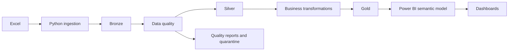

# Architecture and deployment choices

Bronze is an append-by-batch evidence store. Each batch keeps source cell values, physical worksheet row, source name, SHA-256 checksum, UTC ingestion timestamp/date and batch ID. JSON Lines intentionally preserves heterogeneous cell types that can make raw Parquet inference unsafe. The original Excel is retained unchanged. Minimal processing makes defects traceable, allows different validation policies to replay source data and prevents cleaning from destroying evidence. JSON serialization does not preserve workbook formatting or formulas; the workbook is authoritative for those.

Silver owns schema, identity, category normalization, numeric conversion, anomaly flags and configured bands. Null keys and later duplicate occurrences go to quarantine; invalid measures become null and carry quality evidence. Other attributes remain usable. Quality is evaluated against pre-cleaning Bronze so nullification does not hide invalid inputs.

Gold owns the business grain and metric definitions. It creates dimensions, a current customer financial fact, rule segments, country/age/credit summaries, executive KPIs and value-score sensitivity. The dimensions repeat several required financial attributes for the requested dictionary; those copies are hidden in BI. All financial measures read the fact.

Local storage is private, batch-scoped JSON/Parquet/CSV plus a batch DuckDB warehouse. Gold becomes discoverable through an atomically replaced `latest_success.json` pointer only after writes and reconciliations. It is a single-writer local design, not a distributed transaction manager. A failed run can leave an unreferenced partial batch; retain it for diagnosis, then ingest a new batch. Do not mutate published files. Automated retention and concurrent-writer locking are deployment work.

The quality gate runs before publication. The requested CLI path is Bronze → Silver → Gold build → integrity validation → export; source quality is also evaluated before Gold to support fail-fast publication policy. EDA follows publication. An EDA failure is logged and raises even if the validated Gold snapshot was already published.

The Databricks adapter uses the same bounded Pandas rules for the small Excel dataset, typed PySpark DataFrames and Delta writes. Bronze/audits append; curated tables replace the current snapshot. Delta is transactional **per table**, not across the collection of tables. Run as a single job, prevent overlapping writers and refresh BI only on successful job completion. A production implementation should write run-scoped tables and publish versioned views together under an orchestrator rather than let readers observe sequential overwrites. A native Spark SQL country aggregate demonstrates processing over Delta. No Databricks workspace execution is claimed by local tests.

For a much larger source, land governed Parquet/Delta first, translate shared validation rules into Spark expressions, compare outputs to the fixture suite, and add distributed key checks. Do not collect a large Spark source into driver memory.

Orchestration can call the CLI by stage from Databricks Workflows, Airflow or Azure Data Factory. All dependencies are explicit artifacts and batch IDs. No orchestration service is needed for the local portfolio version.

References: [Delta writer API](https://learn.microsoft.com/en-us/azure/databricks/pyspark/reference/classes/dataframewriter/saveastable), [schema write options](https://docs.databricks.com/aws/en/spark/api-options), [Power BI star schema guidance](https://learn.microsoft.com/en-us/power-bi/guidance/star-schema).
