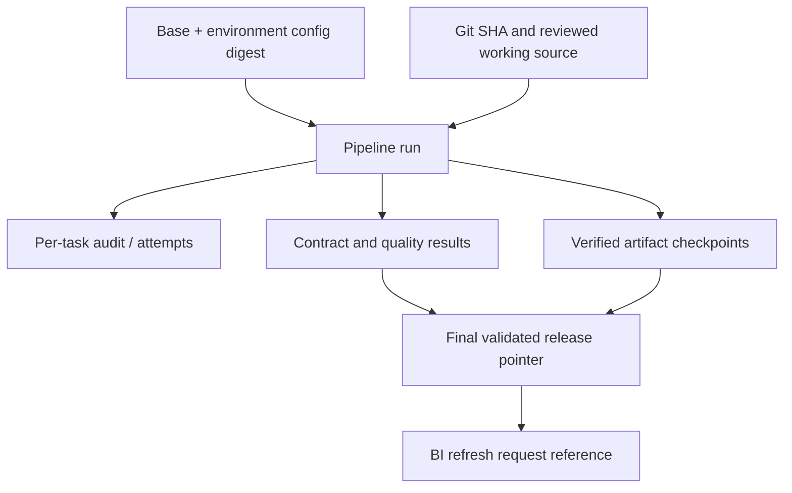

# End-to-end lineage

```mermaid
flowchart LR
  A[Authorized source workbook + checksum] --> B[Bronze batch + ingestion manifest]
  B --> C[Accepted Silver + quarantine + contracts]
  C --> D[Gold dimension/fact build]
  D --> E[Synthetic behavior / Customer 360]
  E --> F[Cutoff-dated features + checksum]
  F --> G[Versioned payroll/campaign/churn/service models]
  G --> H[Customer ML scores + model versions]
  H --> I[Opportunity SQL mart + reasons]
  I --> J[Validated release + Power BI parameters]
  J --> K[Restricted Next Best Action report]
```

Every task checkpoint identifies dependencies and output locations/checksums. Audit includes run/batch/attempt, code version and source version; source metadata includes path, modification time and SHA-256. Feature manifests include scoring cutoff and content digest. Scoring retains original training model versions and new batch lineage, rather than claiming a model was retrained on its scoring input. Release manifests identify source, populations and coherent export directories.

Unity Catalog automatic lineage would supplement this technical lineage in the Azure reference. It is not configured or claimed from local paths. Field-level business definitions remain in the existing data dictionary, ML feature policy, model cards and metric catalogs.
