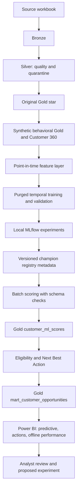

# Synthetic predictive banking architecture

Every behavioral prediction is a **SYNTHETIC DEMO MODEL**. Original customer master data supplies the cohort; model inputs are reconstructed synthetic histories. No model was trained on real banking customer behavior.

`run_ml_pipeline.py` extends the existing repository. It never rebuilds upstream Medallion datasets. Reusable logic lives in `ml/src`; seven notebooks call that code and inspect stored evidence. Config is `ml/config/ml_config.yaml`. Four supervised models and a rules/model action ranker are distinct components; Next Best Action is not a fifth trained classifier.

Gold feature grain is `(customer_key, prediction_date)`; score and opportunity grain is `(customer_key, scoring_date)`. Immutable scored builds live in `data/gold_ml/predictions/build_id=...`; `data/reports/latest_ml.json` advances only after all outputs are written. Each build contains a DuckDB database with `gold.ml_customer_features`, `gold.customer_ml_scores`, and `gold.mart_customer_opportunities`, Parquet, CSV exports and checksums. Feature generation itself writes the latest reconstructible feature artifact and a manifest; do not run concurrent feature builds/training.

Training stores full preprocessing/model pipelines, selected calibration, config digest, working-source digest (including uncommitted code), Git revision, dataset digest, features, periods, thresholds and MLflow run ID. Local registry metadata follows Candidate → Champion → Archived. Joblib is loaded only from controlled local artifacts with checksum validation; a checksum does not make an untrusted pickle safe.

Scoring validates the source build and training configuration, applies eligibility masks, retains null probabilities for ineligible payroll/service customers, and writes synthetic labels and model versions. A standardized Email / Cross-Sell context defines campaign scores; they are not universal offer probabilities. Monitoring is descriptive and never automatically retrains or sends campaigns.
