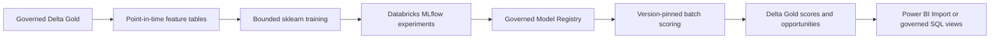

# Databricks migration design

The local implementation is **SYNTHETIC DEMO MODEL**. It has not been executed on a Databricks workspace. Retain sklearn training for this small dataset; rewriting all models in Spark adds little value. For larger histories, prepare event-time windows and label joins in Spark/SQL using the same half-open bounds and partition by prediction month. Avoid collecting the entire event lake: materialize bounded training feature slices and assert a driver memory budget before conversion to Pandas.

Replace local SQLite URI with the organization's workspace MLflow tracking and controlled artifact storage. Register the complete preprocessing/model package with signature, feature-policy digest, dataset lineage and approved alias promotion. Replace the local joblib loader with a version-pinned approved registry URI and environment lock. Use mapInPandas or a model UDF with explicit schema, partition checks, null eligibility outputs and row-count reconciliation. Publish Delta scores by immutable scoring date/build ID and switch a latest-success view only after validation. Coordinate score/opportunity publication rather than claiming a cross-table atomic transaction.

An orchestrated job graph can depend on successful Gold publication, feature contracts, training evaluation, approval and batch reconciliation. Access control, real consent, audit logs, data retention, CI/CD, isolated serving identities, secrets, monitoring and regulatory review belong to productionization. No placeholder credentials, speculative RLS identities or remote deployment is introduced here.
