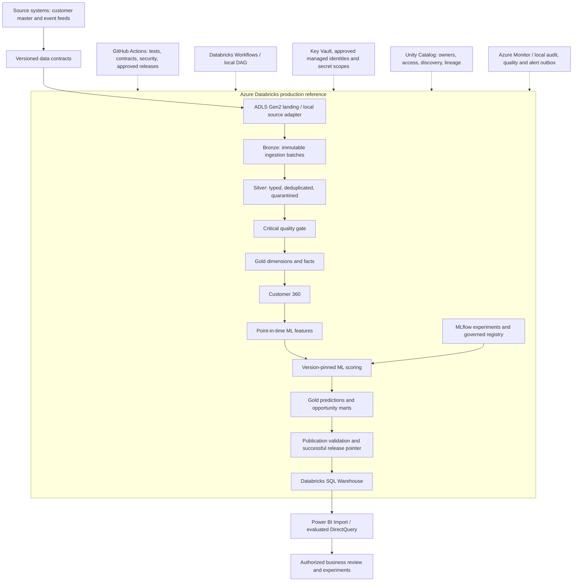

# Banking platform: implementation and production reference

The portfolio implementation runs locally using the existing Python/SQL transformations, Parquet, sklearn and controlled local model artifacts. New orchestration, contracts, audit, gates and recovery are executable. Azure/Databricks deployment assets are a **production reference**, not evidence of a cloud deployment. All behavioral data and models remain **SYNTHETIC DEMO MODEL**. Weak model performance is not changed by operational controls.

Thirteen local stages match the daily reference job DAG. Gold dimensions/facts reuse the existing shared enrichment builder; the dimension task computes shared private staging once and the dependent fact task materializes the full Gold snapshot. Customer 360 reuses the existing synthetic Bronze/Silver/Gold generation and validation, including six typed behavioral contracts. It does not manufacture real-time bank events.

Each environment writes under `data/platform/<environment>/runs/<run_id>`, with attempt-isolated outputs. The kernel-managed environment lock prevents concurrent local publication writers and is released on process exit. Local SQLite is a technical audit store, not a distributed coordination mechanism. Successful checkpoints have artifact checksums; invalid ones cannot be silently reused. Final publication advances only after stage 13 validates all export row counts and exact Int64 customer-key recovery. The previous successful release remains visible on failure.

DEV reuses the prior checksum-validated synthetic champions without retraining. Model input names and eligibility are shared with the existing scoring implementation. A new DEV batch records both new source provenance and original training model versions; it does not pretend the new batch is the training dataset. TEST trains only constant-prior fixture models on early historical windows, explicitly labeled Development. Current models cannot enter Production lifecycle states.

PROD configuration deliberately rejects local demo execution. The paused Databricks jobs require a governed Delta task adapter, approved identities, actual catalog/Volume locations and workspace validation. `task_entry.py` fails closed until that adapter exists. Local SQLite/Parquet operations must not be presented as distributed transactional Delta jobs. No cloud resources, model serving, external alerts or Power BI Service refresh were deployed.

Reference choices follow [Databricks task dependency controls](https://docs.databricks.com/aws/en/jobs/run-if), [bundle deployment modes](https://learn.microsoft.com/en-us/azure/databricks/dev-tools/bundles/deployment-modes), and [bundle production configuration](https://learn.microsoft.com/en-us/azure/databricks/dev-tools/bundles/reference). The existing-cluster variable makes assets reviewable without inventing a VM/runtime; an approved job compute policy should replace/restrict it before enabling schedules.
