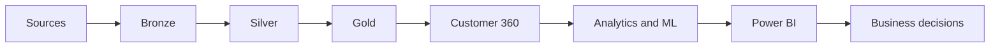

<!-- Generated from docs/architecture/interview.md; edit canonical source. -->

# Architecture in 30 seconds

“I preserve the source, validate and quarantine bad records, then publish customer-level facts and business views. Customer 360 connects those views to behavioral analytics and demonstration models. Power BI explains the evidence, and experiments show how I would decide whether an action should scale. The behavior and experiment outcomes are synthetic.”

The exact scoring branch is Excel / sources → Bronze → Silver → Gold → Customer 360 → feature engineering → ML → Gold predictions → Power BI → experimentation review → business decision. Experiment computation is a separate downstream branch, not a transformation inside Power BI.
