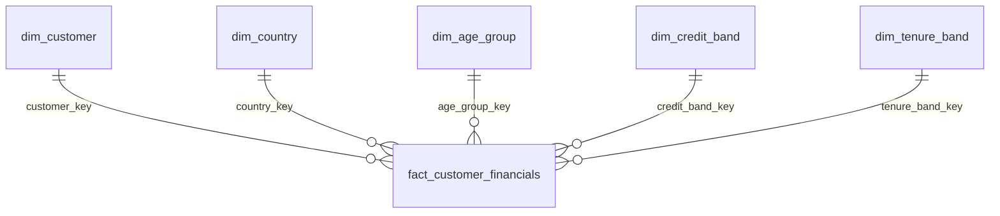

# Gold star schema — specification for the next Power BI phase

Load one successful Gold build. The current fact grain is one accepted customer in the source snapshot, not one transaction and not a dated observation. No business date is invented.

| Table | Grain | Primary key | Foreign keys / relationship role |
|---|---|---|---|
| dim_customer | One accepted customer | customer_key | Contains lookup keys for lineage, but create **no relationships** from these dimension copies |
| dim_country | One observed country + Unknown | country_key | Directly filters fact |
| dim_age_group | One configured age band + Unknown | age_group_key | Directly filters fact; sort label by sort_order |
| dim_credit_band | One configured credit band + Unknown | credit_band_key | Directly filters fact; sort label by sort_order |
| dim_tenure_band | One configured tenure band + Unknown | tenure_band_key | Directly filters fact; sort label by sort_order |
| fact_customer_financials | One customer in the current snapshot | customer_key, unique in current data | Five foreign keys to the dimensions above |

All five active relationships are dimension **1 → many** fact, single-direction. Even though customer_key is unique in this snapshot fact, configure the intended one-to-many direction explicitly. Avoid automatic one-to-one/bidirectional detection. Each dimension has unique non-null integer keys; lookup key 0 is Unknown. Customer keys are positive. Hash truncation can collide in theory; collision/uniqueness checks block publication rather than merging identities.

The customer dimension repeats financial values and lookup keys because they are useful in restricted customer lineage/profile extracts. Hide those copies from report authors and use fact-based measures. Do not connect dim_country to dim_customer as well as the fact: that would introduce redundant/snowflake paths. Countries, age, credit and tenure slicers use their dedicated dimensions; gender, value tier and primary segment use dim_customer.

Marts are alternate analytical products. Do not join summary marts to the fact or import every redundant aggregate into the interactive model. A dedicated lightweight country-summary report can use a country mart alone, provided its fixed grain and limited filtering are clear. No many-to-many or bidirectional relationships are needed.

The current PBIP implements this six-table core star using business-friendly names. Three disconnected cohort/control tables and _Measures bring the total to ten tables. TMDL and PBIR are authored and structurally validated; native execution remains pending. Older .bim/root .pq assets are historical references.
